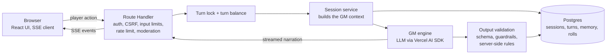

# Tavern Forge

An online fantasy tabletop RPG with an AI game master. Solo play, in the browser, no scheduling and no rulebooks required.

## Why

I love fantasy tabletop RPGs and I work with AI, and I wanted the best of both. Tavern Forge is the product I would use myself: a way to play when there is nobody to play with and no evening free to organise. It is also the project where I test my own multi-agent development system on something real, changing it every day.

## Status

- Closed beta since September 2026. Sign-up is disabled; access is by invitation.
- No payments. Beta testers get a free turn allowance, there is no billing.
- Deployed manually from `main`; builds are not automatic.
- First commit 14 Aug 2026, last analysed commit 16 Oct 2026.

## Stack

- **Frontend**: Next.js (App Router), React, TypeScript in strict mode, Tailwind CSS with OKLCH design tokens, zustand, react-hook-form, zod, in-house i18n.
- **Backend**: Next.js Route Handlers on the Node runtime, layered as route → service → repository, with a custom Server-Sent Events stream for game turns.
- **Database**: Postgres on Supabase, Drizzle ORM, hand-written SQL migrations.
- **Auth and storage**: Supabase Auth (email and password), Supabase Storage for character portraits.
- **AI**: Vercel AI SDK; the game master runs on Claude Haiku 5.5 through OpenRouter, with Gemini as an alternative provider. Portraits and story images come from an image generation API.
- **Hosting and monitoring**: Netlify, Sentry on client and server, an uptime check on a health endpoint.
- **Quality**: Vitest, Testing Library, jest-axe, Playwright with axe, GitHub Actions (lint, typecheck, unit tests, build), Dependabot.

## Architecture

A player action goes to a single route handler that authenticates the user, checks the request origin, bounds the payload, applies a per-user rate limit and screens the text for moderation and prompt injection. The handler takes a per-session turn lock and debits one turn before anything is spent on AI. The session service assembles the game master context from the database and streams the model's narration back to the browser as Server-Sent Events. After the stream ends, the output is validated against a strict schema, run through the guardrails, and only then persisted: turns are append-only and every number that matters (dice, experience, equipment) is computed by the server, not by the model.

The browser has no direct database access. Every read and write goes through the API, and every repository query is scoped to the authenticated user.

## Key technical decisions

### 1. Campaign memory without unbounded prompts

**Problem.** A long campaign has thousands of turns. Sending the whole history every turn is too expensive, and the model loses the thread anyway.

**Choice.** Four layers of memory, each with a hard cap.
- A rolling summary, regenerated on pause and every few turns. It is saved with a compare-and-swap checkpoint, so concurrent writes cannot corrupt it.
- A structured session memory with the known facts and the current scene, updated by delta.
- A verbatim window of the latest turns.
- A lexical recall step with no AI call. It pulls at most three short passages from older turns that match the current request.

The character's diary is a fifth, player-visible layer, with entries the player can bring back.

**Trade-off.** Details that fall out of every layer are gone for the model. Recall is lexical, not semantic, so it misses paraphrases. In exchange it costs nothing and is fully deterministic.

### 2. The game master narrates, the server decides

**Problem.** A language model asked to apply rules invents numbers, rolls dice in its favour, or lets the player talk things into existence.

**Choice.** The model returns a structured JSON object, validated against a strict schema.
- Dice are rolled by the server before the model sees them. A retry reuses the same rolls.
- Experience, damage, level-ups, equipment changes and travel events are computed server-side.
- The model only classifies the player's action among options the server hands it by index.
- A guardrail scans the output for protected third-party names. Limits on player agency reject attempts to grant oneself gold, items or allies.
- The world, Xoria, is a static dataset owned by the project.

**Trade-off.** The schema is large, and every new mechanic means a schema change plus server rules. The narration is less free, which is the point.

### 3. Cost and latency control

**Problem.** Every turn is a paid LLM call with a long context. A stuck or abusive client can burn money fast.

**Choice.**
- A small model, chosen after a side-by-side comparison.
- A system prompt split into static, session and per-turn sections, so provider-side prompt caching applies to the stable parts.
- One turn at a time per session, enforced by a database lock with a timeout.
- A turn balance debited in a single SQL statement that cannot go negative, and per-user rate limits that fail closed.
- At most one automatic regeneration, when the output is truncated or incoherent.
- A server-only log of every AI call, with token counts and estimated cost.

**Trade-off.** The lock means a player cannot fire two actions at once, which the UI has to explain. The cheaper model needs more server-side correction than a larger one would.

### 4. Failing safely

**Problem.** The provider times out, returns malformed JSON, or the connection drops mid-stream.

**Choice.**
- Timeouts on the first call and on retries.
- The client always receives the project's own error codes and messages, never the provider's.
- Errors that happen while streaming are sent as events inside the stream, so the UI can react.
- A dedicated retry endpoint resumes with the same dice and the same context.
- An idempotency key on character creation.
- The turn lock is released only once the whole payload has settled, which is designed to keep a crash from leaving a session half-written.

**Trade-off.** More states to test. A good share of the unit tests exist for these paths.

### 5. Defence in depth around player data

**Problem.** A game backend holds personal data and a paid AI budget, and the frontend is the attack surface.

**Choice.**
- The anonymous and authenticated database roles have no privileges on application tables. The browser can only talk to the API.
- Every repository filters by user id.
- Cross-site requests are rejected by origin checks. A per-request Content Security Policy nonce is set in middleware.
- Request bodies are size-limited and parsed with bounded schemas.
- Player text enters the prompt only inside a fenced block, after an injection check.
- Nearly every invariant is backed by an automated guard test that runs before every merge. The one that is not has a written runbook.

**Trade-off.** Some operations are slower to build, because nothing can take a shortcut through the database client.

## How it's built

The project is developed with a multi-agent system on Claude Code that I built and maintain. Each feature goes through the same pipeline:

1. **Requirements**: an analyst agent turns the request into a requirements document and checks feasibility on the codebase.
2. **Design**: an architect agent writes the technical design and keeps a single directives file that every other agent follows.
3. **Tasks**: a task-writer agent splits the design into small tasks grouped into waves that can run in parallel.
4. **Waves**: one developer agent per task, each on its own git worktree, opening a pull request against the wave branch.
5. **Review**: a reviewer agent checks every pull request against the task and the directives before merge.
6. **Verification**: a tester agent writes the end-to-end tests and a security agent reviews the wave's diff before it reaches `main`.

Two months of work, one developer and the agent system. Numbers from the repository, as of 16 Oct 2026:

| Measure | Value |
|---|---|
| Features through the agent pipeline | 34 |
| Waves | 153 |
| Merged pull requests | 2,496 |
| Commits on `main` | 1,638 |
| Unit test files | 801 |
| End-to-end spec files | 100 |
| SQL migrations | 63 |

---

Source code is proprietary. A live demo is available on request.

[LinkedIn](https://www.linkedin.com/in/fabio-cabiddu-939053159/)
